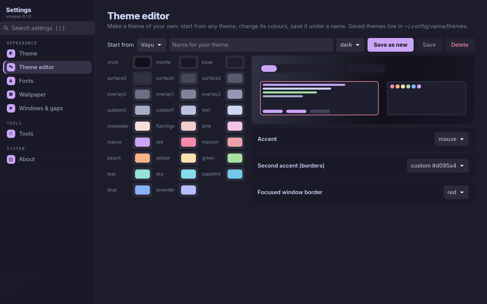
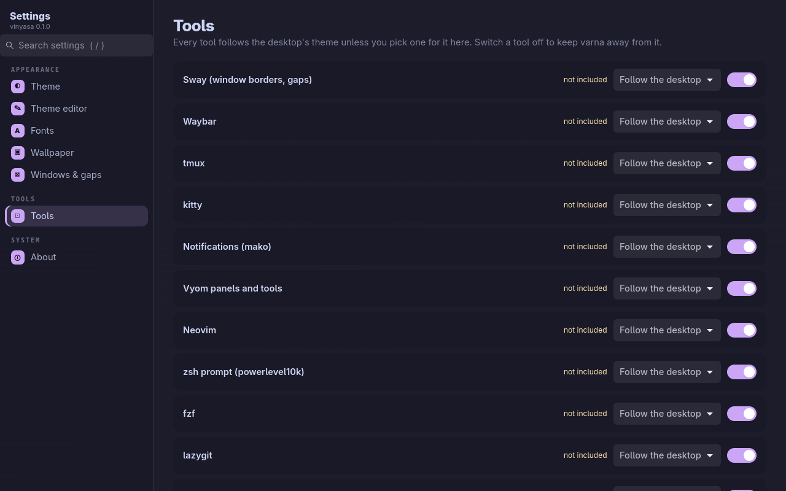

<p align="center">
  <picture>
    <source media="(prefers-color-scheme: dark)" srcset="assets/banner-dark.svg">
    <source media="(prefers-color-scheme: light)" srcset="assets/banner-light.svg">
    
  </picture>
</p>

<p align="center">
  <b>Every setting of the desktop, in one place.</b><br>
  Vayu's settings app: pick a theme and the whole desktop follows, make your own, set fonts, wallpaper and window gaps, and give any tool its own theme. Keyboard first.
</p>

<p align="center">
  <a href="https://github.com/Theyashsawarkar/vinyasa/actions/workflows/ci.yml"></a>
  <a href="https://github.com/Theyashsawarkar/vinyasa/releases"></a>
  <a href="LICENSE"></a>
  
</p>

> *Vinyasa* (विन्यास) is Sanskrit for "arrangement": setting things in their place.

GNOME and KDE each have one settings app; a tiling Wayland desktop usually
has a folder of config files. **vinyasa** is the settings app for
[Vayu](https://github.com/Theyashsawarkar/vayu): a GTK 4 window with a page
per area, a search box that finds any setting, and vim keys. Its core is
themes: it drives [varna](https://github.com/Theyashsawarkar/varna), which
sends one theme to every tool (sway, waybar, tmux, kitty, Neovim,
notifications, panels, the prompt, the lock screen) and reloads them live.

<p align="center">
  
</p>

## Contents

- [Pages](#pages)
- [Install](#install)
- [Keys](#keys)
- [How it works](#how-it-works)
- [Contributing](#contributing)
- [License](#license)

## Pages

| Page | What you set |
| --- | --- |
| **Theme** | The desktop's theme (cards drawn in each theme's colours), the accent colour, dark/light twin, terminal transparency, whether GTK apps follow too |
| **Theme editor** | Your own theme: start from any theme, change any of its 26 colours and its accents with a live preview, save it under a name, delete it |
| **Fonts** | The interface font and size (GTK apps) and the monospace font and size (kitty) |
| **Wallpaper** | Pick one from `~/Pictures/Wallpapers`, turn the daily wallpaper on or off, fetch today's |
| **Windows & gaps** | Gaps, border width, corner radius (sway, SwayFX) |
| **Tools** | Every tool follows the desktop unless you pick a theme for it; switch a tool off to keep the theme away from it; tools whose config doesn't include varna yet are marked |
| **About** | Versions, re-apply the theme everywhere, your themes folder, every tool's status |

Every change applies at once and the app restyles itself to match. Coming
next: Wi-Fi, Bluetooth, sound, displays, keyboard, power, notifications,
keybindings, date and language.

<p align="center">
  
  
</p>

## Install

With [kosha](https://github.com/Theyashsawarkar/kosha) (installs varna too):

```sh
kosha install vinyasa
```

Or by hand: install [varna](https://github.com/Theyashsawarkar/varna#install),
then `git clone https://github.com/Theyashsawarkar/vinyasa ~/.local/share/vinyasa && ln -s ~/.local/share/vinyasa/bin/vinyasa ~/.local/bin/vinyasa`.

**Requirements:** Python 3.11+, GTK 4.10+ with PyGObject (`python-gobject`,
`gtk4` on Arch), varna. Optional: SwayFX for rounded corners, `swaybg`.

`vinyasa` opens it; `vinyasa --page=wallpaper` opens on a page. In Vayu,
`Super+,` opens it.

## Keys

| Key | Does |
| --- | --- |
| `j` / `k` | Next / previous page (in the sidebar), down / up a row of cards or the next / previous control (in a page) |
| `h` / `l` | The sidebar / the page |
| `gg` / `G` | First / last page |
| `/` | Search every setting (theme and tool names too); `Enter` opens the first match |
| `Enter` / `Space` | Open the page, pick the card, change the setting |
| `Tab`, arrows | Move between controls as usual |
| `?` | All keys |
| `q` / `Esc` | Quit (`Esc` in the search box clears it) |

## How it works

vinyasa holds no settings of its own. Theme, accent, fonts, gaps and
per-tool picks are varna's (`~/.config/varna/varna.toml`, applied with
varna's engine, so `varna` on the command line and vinyasa always agree);
the wallpaper is `~/Pictures/Wallpapers/current.jpg` and `wallpaper.timer`;
fonts also go to GTK's settings. Applying runs in the background, so the
window never freezes while tools reload.

## Contributing

See [CONTRIBUTING.md](CONTRIBUTING.md); design decisions are in [docs/adr](docs/adr).

## License

[MIT](LICENSE).
